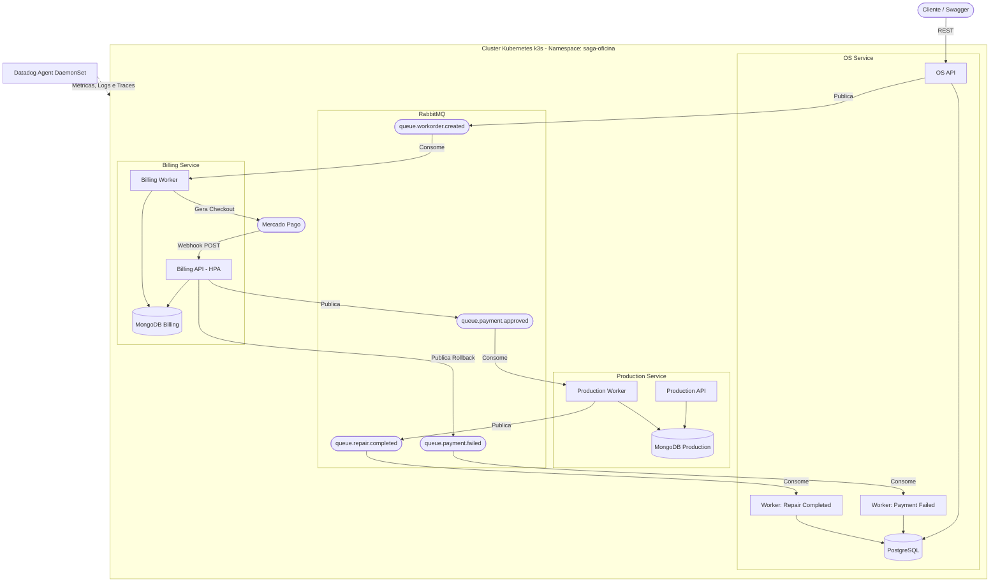

# Tech Challenge SOAT — Arquitetura de Microsserviços (Saga Oficina)

Repositório central de infraestrutura, orquestração Kubernetes (`k3s`), observabilidade e documentação arquitetural do ecossistema de gestão de oficina mecânica baseado em **Microsserviços Orientados a Eventos** e **Padrão Saga Coreografada**.

## Links do Projeto

* **Vídeo Demonstrativo (YouTube):** [Assistir à apresentação completa](https://www.youtube.com/watch?v=B8lvNmdKo58)
* **OS Service (Ordens de Serviço):** [`tc-os-service`](https://github.com/william-moura/tc-os-service)
* **Billing Service (Faturamento e Pagamentos):** [`tc-billing-service`](https://github.com/william-moura/tc-billing-service)
* **Production Service (Produção e Reparo):** [`tc-production-service`](https://github.com/william-moura/tc-production-service)
* **Infraestrutura Kubernetes:** [`tc-soat-k8s-infra`](https://github.com/william-moura/tc-soat-k8s-infra)

---

## Visão Geral da Arquitetura

O sistema segue uma arquitetura de **microsserviços orientados a eventos** (*Event-Driven Architecture*), implantada em um cluster **Kubernetes (`k3s`)** e dividida em três contextos delimitados (*Bounded Contexts*) independentes, cada um com seu próprio banco de dados (*Database per Service*), API REST e workers assíncronos.

### Diagrama de Componentes e Mensageria



### Mapa de Microsserviços e Persistência

| Microsserviço | Repositório | Banco de Dados | Responsabilidade Principal |
| :--- | :--- | :--- | :--- |
| **OS Service** | `tc-os-service` | PostgreSQL | Abertura e ciclo de vida das Ordens de Serviço (`PENDING`, `IN_PROGRESS`, `COMPLETED`, `CANCELED`). |
| **Billing Service** | `tc-billing-service` | MongoDB | Geração de faturas, criação de links de pagamento no Mercado Pago e processamento de webhooks. |
| **Production Service** | `tc-production-service` | MongoDB | Recebimento de ordens aprovadas, execução do reparo na oficina e emissão de conclusão. |
| **Infraestrutura** | `tc-soat-k8s-infra` | — | Manifestos Kubernetes (`Deployments`, `Services`, `HPA`, `Secrets` e `Datadog Agent`). |

### Infraestrutura, Escalabilidade e Observabilidade

* **Orquestração (`k3s`):** Todos os serviços, workers consumidores e bancos de dados rodam isolados no namespace `saga-oficina`, com descoberta interna via DNS do Kubernetes e exposição externa via `NodePort`.
* **Escalonamento Automático (HPA):** O `billing-api` conta com *Horizontal Pod Autoscaler* para absorver picos de notificações de webhook e consultas de faturamento sem degradação.
* **CI/CD (GitHub Actions):** Pipelines automatizados validam qualidade de código, executam testes automatizados e realizam build e atualização das imagens nos deployments.
* **Observabilidade (Datadog):** Um *DaemonSet* do `datadog-agent` coleta métricas de infraestrutura dos nós e containers (`containerd`), centraliza os logs de todos os pods e alimenta dashboards e monitores de alerta em tempo real.

---

## Decisões Arquiteturais: Padrão Saga

### 1. Escolha pela Saga Coreografada

Para garantir consistência eventual entre os microsserviços **OS Service** (PostgreSQL), **Billing Service** (MongoDB) e **Production Service** (MongoDB) sem acoplamento temporal ou ponto único de falha, adotamos o padrão **Saga Coreografada** mediada pelo **RabbitMQ**.

* **Por que Coreografada e não Orquestrada?** O fluxo da oficina possui uma cadeia linear e bem definida de eventos de domínio (`workorder.created` → `payment.approved` / `payment.failed` → `repair.completed`). A coreografia evita a criação de um orquestrador centralizado que concentraria regras de negócio de três contextos delimitados distintos, mantendo cada microsserviço autônomo e escalável de forma independente no Kubernetes.
* **Isolamento de Dados (*Database per Service*):** Cada serviço persiste seu estado em seu próprio banco de dados (relacional para o controle transacional de Ordens de Serviço e NoSQL para faturas e filas de produção), eliminando transações distribuídas síncronas (2PC).

### 2. Fluxo Principal (*Happy Path*) e Compensação (*Rollback*)

* **Caminho Feliz (*Happy Path*):** A criação da OS dispara a geração da fatura e da preferência de pagamento no Mercado Pago. Ao receber o webhook de aprovação, o `billing-service` publica `queue.payment.approved`, liberando a execução do reparo no `production-service` e concluindo a OS (`COMPLETED`) após o evento `queue.repair.completed`.
* **Transação Compensatória (*Rollback*):** Caso o pagamento seja recusado ou cancelado no gateway, o `billing-service` marca a fatura como `REJECTED` e publica o evento de compensação na fila `queue.payment.failed`. O consumidor dedicado no `os-service` processa a falha e executa a ação compensatória, transitando a Ordem de Serviço para `CANCELED` e impedindo que o veículo avance para a linha de produção.

### 3. Tolerância a Falhas e Idempotência

Em arquiteturas orientadas a eventos com entrega *at-least-once* e webhooks externos (Mercado Pago), notificações duplicadas são esperadas. Para evitar efeitos colaterais ou exceções de transição de estado inválida:

* **Consumidores Idempotentes:** Os casos de uso de transição de status (como `CancelWorkOrderUseCase`) validam o estado atual da entidade antes de aplicar mutações, realizando *early return* seguro caso o estado alvo já tenha sido atingido.
* **Confirmação Explícita (*Manual ACK*):** Os workers só confirmam (`ack`) o consumo da mensagem no RabbitMQ após a persistência bem-sucedida no banco de dados e a publicação do próximo evento da cadeia.

---

## Implantação no Cluster (`k3s`)

1. **Configure os Secrets** com suas credenciais de banco de dados, RabbitMQ, Mercado Pago e `DD_API_KEY` do Datadog (nunca versione chaves reais no repositório).
2. **Aplique os manifestos no cluster:**

```bash
kubectl apply -f k8s-manifests/
kubectl get pods -n saga-oficina
kubectl get pods -n default -l app=datadog-agent
```